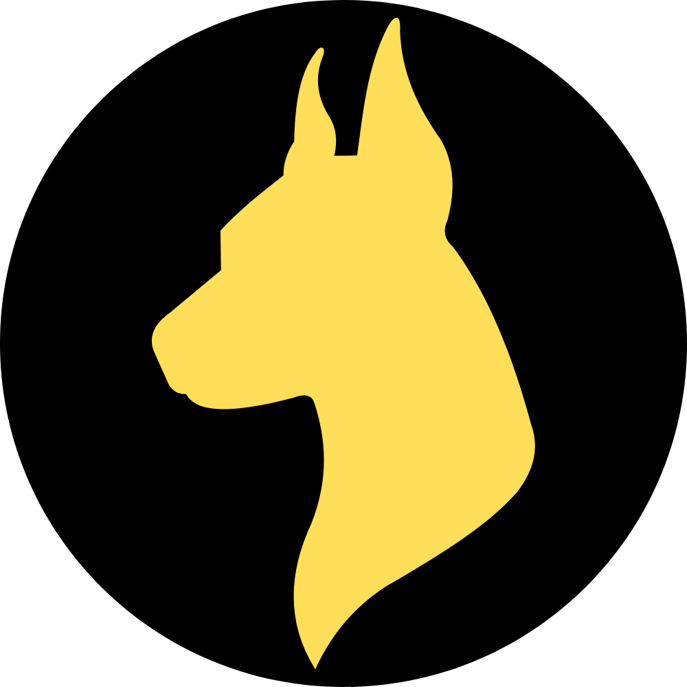
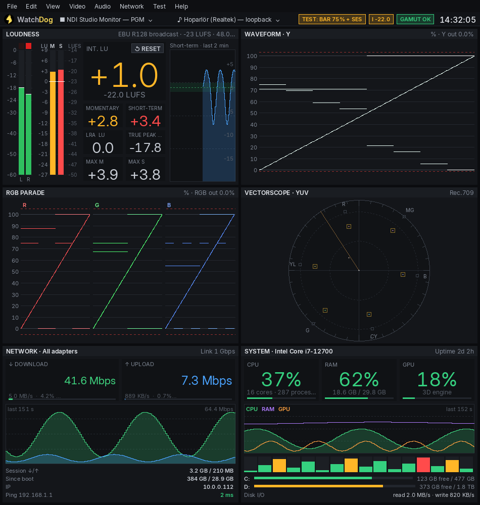

# WatchDog — downloads / indirmeler

**English** — WatchDog is a Windows desktop app for the broadcast monitoring desk: loudness (ITU-R BS.1770-4 / EBU R128), video scopes (waveform, RGB parade, vectorscope, histogram), multiple previews, network and system meters, and a built-in test signal. Grab the latest `WatchDog.exe` from the [Releases](../../releases) page — a single file, no installation.

**Türkçe** — WatchDog, yayın izleme masası için bir Windows masaüstü uygulamasıdır: loudness (ITU-R BS.1770-4 / EBU R128), video scope'ları (waveform, RGB parade, vectorscope, histogram), çoklu önizleme, ağ ve sistem göstergeleri, dahili test sinyali. En son `WatchDog.exe` dosyasını [Releases](../../releases) sayfasından indirebilirsiniz — tek dosya, kurulum gerekmez.

## Requirements / Gereksinimler

- Windows 10 or 11 (64-bit) / Windows 10 veya 11 (64-bit)
- NDI features need [NDI Tools](https://ndi.video/tools/) installed / NDI özellikleri için NDI Tools kurulu olmalı

Windows may show a SmartScreen warning because the file is not code-signed: **More info › Run anyway**.
Dosya imzalı olmadığı için Windows SmartScreen uyarısı çıkabilir: **Ek bilgi › Yine de çalıştır**.

## License / Lisans

[Apache License 2.0](LICENSE) — © 2026 ktysysl
